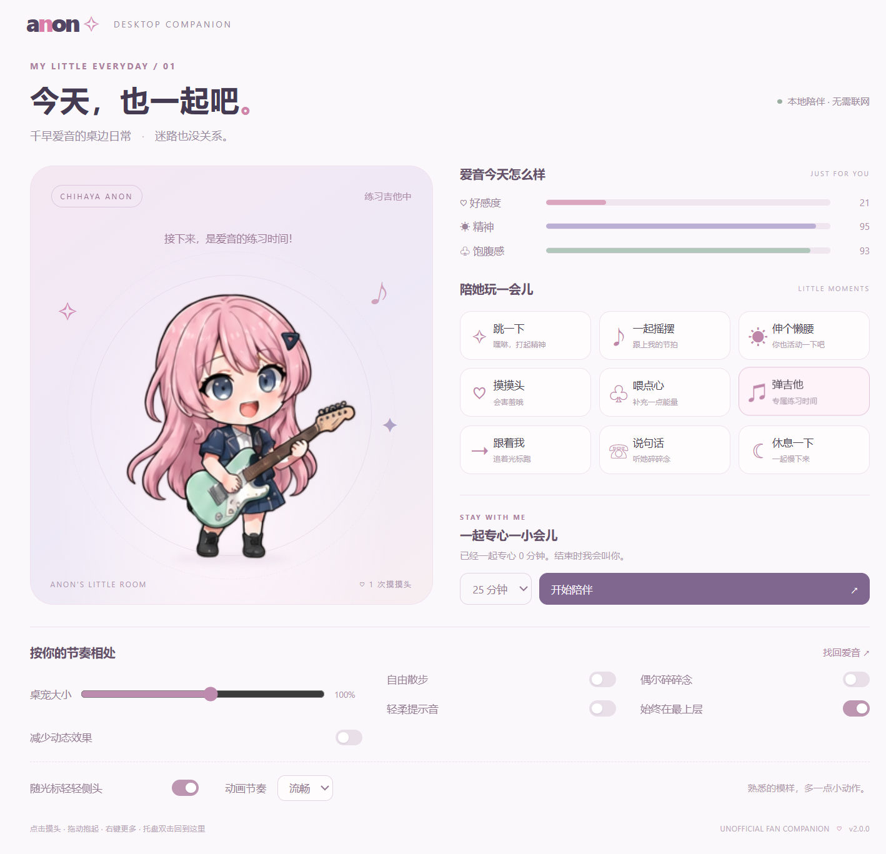
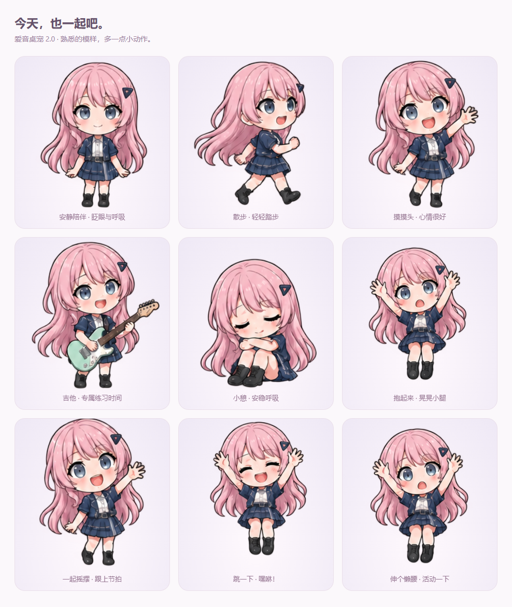

# 爱音桌宠 2.0 · Anon Desktop Pet

**今天，也一起吧。** 独立运行的千早爱音 Q 版 Windows 桌宠。粉色长发、薄荷色吉他，以及一个会眨眼、散步、害羞的小小陪伴。

不依赖 DSH，不需要 API Key，不需要联网。



## 下载即用

2.0 当前在继续优化实际桌面效果，已先更新源码。可按下方说明从源码运行，或在 **[Windows 构建记录](https://github.com/yokipan77-gif/anon-desktop-pet/actions)** 中下载成功构建的附件；正式发行后会出现在 **[Releases](https://github.com/yokipan77-gif/anon-desktop-pet/releases)**。

Windows 构建产物：

- **`Anon-Desktop-Pet-2.0.0-Portable.exe`**：免安装，双击运行。
- **`Anon-Desktop-Pet-2.0.0-Setup.exe`**：安装版，可选择目录并创建桌面快捷方式。

从 1.0 升级：先从托盘退出旧版，再运行新版。使用同一 Windows 账户时，会继续读取原有设置、好感度、摸头次数和累计专注时间，无需搬动存档。

支持 Windows 10 / 11 x64。首次打开会出现爱音和「小房间」。关闭小房间窗口后，爱音继续留在桌面；右键爱音或托盘图标选择 **退出爱音桌宠** 才会退出。

当前发行包没有商业代码签名，Windows 可能显示未知发布者。仅从本仓库 Releases 下载；同页提供 SHA256 校验文件。

## 怎么和她玩

| 操作 | 爱音的反应 |
| --- | --- |
| 点击头部 | 害羞、闭眼笑、挥手，增加好感 |
| 点击身体 | 说一句小小的鼓励 |
| 拖动角色 | 抱起时踢腿；放手后带惯性落下并轻轻回弹 |
| 右键 / `···` | 互动菜单、喂点心、弹吉他、休息、小房间 |
| 「跟着我」 | 在当前显示器上追随光标的水平位置，持续 18 秒 |
| 「弹吉他」 | 持琴与拨弦动画，默认静音 |
| 「跳一下」 | 蓄力、起跳、落地回弹，给自己打打气 |
| 「一起摇摆」 | 挥手、换表情，跟随节拍轻轻晃动 |
| 「伸个懒腰」 | 举起手臂舒展一下，也提醒你活动身体 |
| 「休息一下」 | 蜷坐睡觉，恢复精神；再点一下叫醒 |
| 「一起专心」 | 5 / 25 / 45 分钟陪伴，暂停自主散步与碎碎念，结束时提醒 |
| 托盘双击 | 打开小房间；找回隐藏的桌宠 |

小房间还可以调节大小、自由散步、碎碎念、提示音、置顶、随光标轻轻侧头、流畅 / 省电与减少动态效果。键盘聚焦角色后按 Enter / 空格也可以互动。

2.0 默认采用 240 × 240 逻辑像素的透明窗口，角色画布约 181 × 181 逻辑像素；比旧版宽高缩小约 29%。大小可调至 60%—135%，会随 Windows 显示缩放换算实际像素。已有的大小百分比也使用这个更紧凑的基准。

## 为什么更灵动

- **24 张独立姿势**，六组动作：待机眨眼、四步行走、摸头反应、吉他、睡觉、被抱起。
- **保留 1.0 的原始角色画稿**，在原图上增加连续的头部偏转、发梢摆动、呼吸和动作缓动；没有重新生成脸型或服装。
- 2.0 的轻量 2D 网格只有 504 个三角形、每帧一次绘制，流畅模式上限 50 FPS、省电模式上限 24 FPS；实际帧率受屏幕刷新率与系统调度影响。隐藏窗口停止绘制；图形接口不可用时自动退回 Canvas 2D 逐帧动画。
- 每组采用不同的节奏，辅以步伐起伏和拖拽摆动。明显不同的姿势直接换帧，避免叠影；睡眠会保持，而非随机打断。
- 情绪和行为有状态转换、时间和互动冷却；专注时自动安静，精神不足时会睡觉。
- 真正的透明桌面窗口，根据角色像素判断交互区域。背景空白处可点击下面的应用。
- 拖拽可移动到其他显示器；位置约束使用显示器工作区域，支持负坐标副屏。拔掉屏幕后可通过托盘找回。

这是 **原画逐帧动画 + 2D 网格变形**，不是 Live2D 分层骨骼模型，也不是 AI 聊天机器人。新互动复用原有的 24 张姿势，再配合连续运动；没有声称增加全新手绘帧。对话来自本地文案；声音只有可选的短音符，没有配音或官方音乐。



## 本地数据

设置、好感度、饱腹感、精神、摸头次数、累计专注分钟和位置保存在 `%APPDATA%/anon-desktop-pet/companion.json`（以 Electron 实际 userData 目录为准）。不会读取屏幕内容、聊天记录或文件；跟随光标、拖动和侧头时仅读取鼠标坐标。无遥测、无登录、无自动开机启动、无在线更新。

## 从源码运行

需要 Node.js 22+ 和 npm：

```powershell
npm ci
npm start
```

如果 npm 环境禁用了依赖安装脚本，需要先运行 `node node_modules/electron/install.js` 下载运行库。

```powershell
npm test          # 行为状态、保存数据校验和物理边界测试
npm run test:app  # 真正启动 Electron，验证窗口、互动、计时、设置、图像渲染
npm run test:art  # 验证网格像素命中、减少动态效果与 Canvas 回退，需要本机 Chrome
npm run dist     # Windows x64 安装版 + 免安装版
```

`test:app` 使用隔离的测试资料目录，退出后截图在 `docs/`，结果在 `test-results/`。对已打包程序测试：设置 `ANON_EXE` 为完整 exe 路径再运行相同命令。打包需要下载 Electron 和 NSIS；已缓存运行库时可传 `-- --config.electronDist=node_modules/electron/dist`。

## 项目结构

- `src/main.cjs`：原生窗口、鼠标穿透、拖拽物理、托盘与保存。
- `src/core.cjs`：可测试的行为状态、互动、计时和物理计算。
- `src/preload.cjs`：受限 IPC 接口，渲染页面没有 Node.js 权限。
- `src/art.js`：2D 网格动画、Canvas 回退与变形后的像素命中检测。
- `src/pet.*` / `src/room.*`：桌宠与控制面板。
- `assets/anon-atlas.png`：透明 4 × 6 动画图集。

## 二次创作说明

非官方同人项目，与 MyGO!!!!! / BanG Dream! 权利人无关联。程序代码采用 MIT 许可；角色及商标权利不因代码许可而转让，详见 [NOTICE](NOTICE)。图集由内置图像生成工具创作，未打包桌面壁纸或官方游戏素材。美术方向与生成提示词见 [art-direction.md](docs/art-direction.md)。
